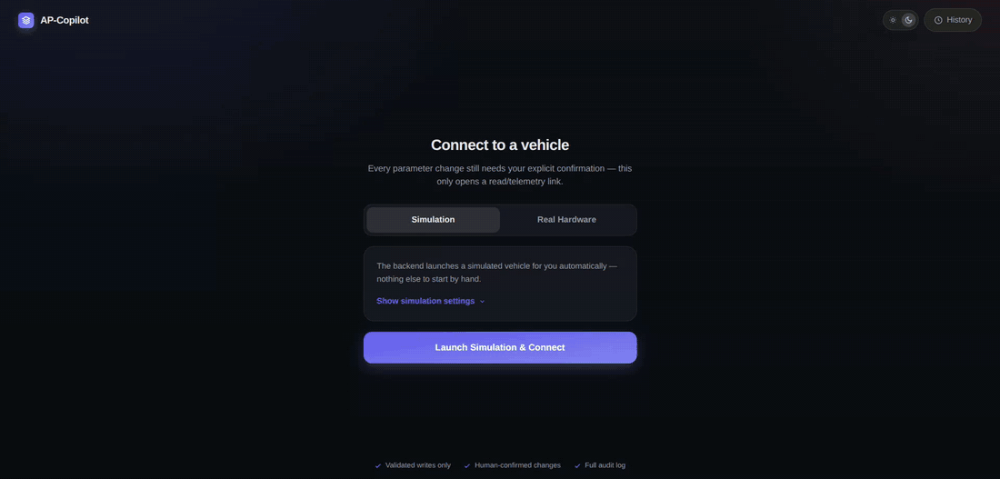
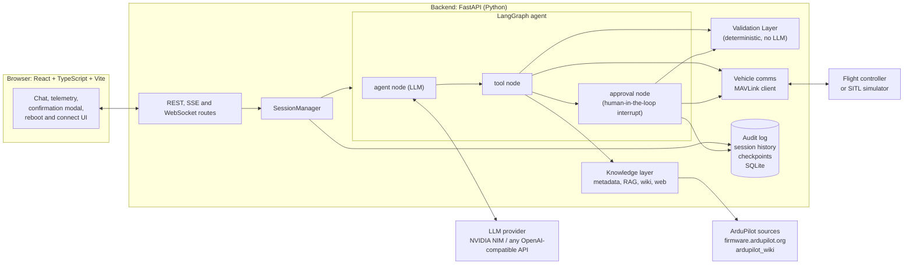
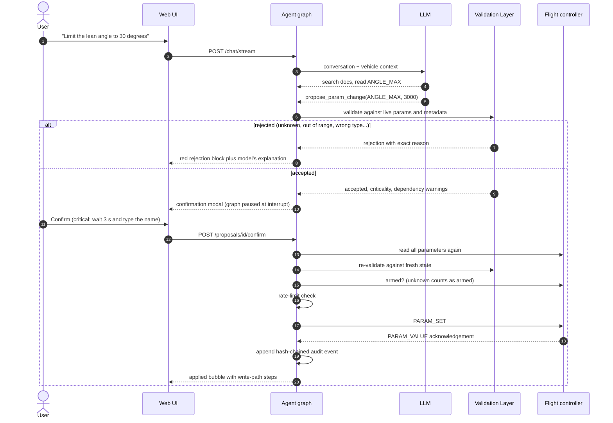
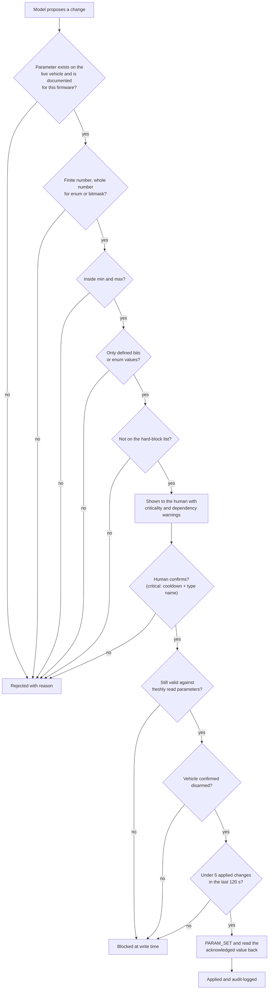
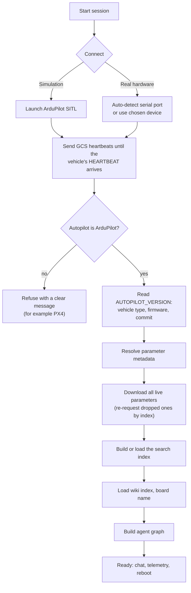
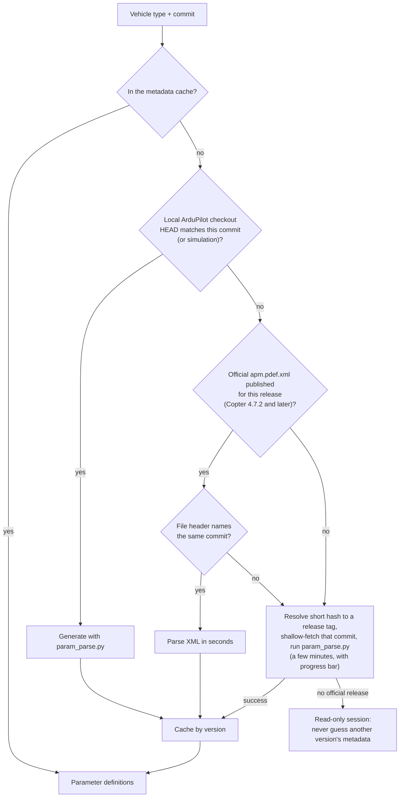
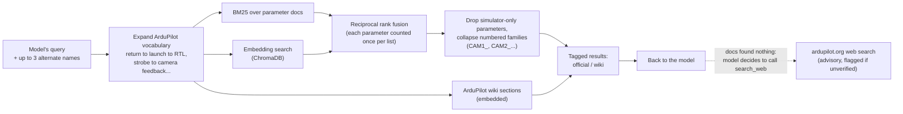
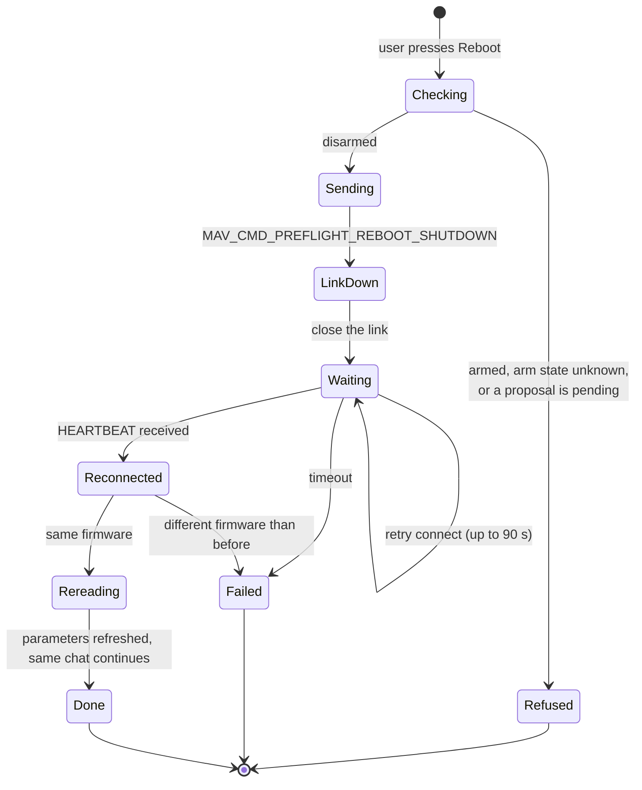

<div align="center">

# AP-Copilot

**A conversational assistant for setting up, tuning and debugging ArduPilot vehicles. The language model proposes; a deterministic safety layer and a human decide.**


[Why](#the-problem) · [Features](#features) · [How it works](#how-it-works) · [Quick start](#quick-start) · [Configuration](#configuration) · [Testing](#testing) · [Evaluation](#evaluation) · [Limitations](#safety-notes-and-limitations)



</div>

---

## The problem

A single ArduCopter board exposes about 1,400 live parameters (the firmware documents nearly 4,800), and their names, ranges and meanings change between versions. Configuring one correctly means reading the right documentation for the *exact* firmware on the board, understanding which parameters depend on each other, and knowing which ones only appear after another is enabled and the autopilot is rebooted.

A general-purpose LLM is a poor fit for that job on its own:

| Failure mode | What goes wrong |
|---|---|
| **Hallucinated parameters** | It invents names (`THR_KILL_FUNC`, `FLUX_CAPACITOR_GAIN`) or uses a name from a different firmware version. |
| **Out-of-range or unsafe values** | It happily proposes `ATC_ANG_RLL_P = 50` or disables arming checks. |
| **Stale knowledge** | `ARMING_CHECK` became `ARMING_SKIPCHK`; `RTL_ALT` became `RTL_ALT_M`; the model remembers the old world. |
| **"Doesn't exist" for things that do** | `CAM1_FEEDBAK_PIN` is documented, but only appears after `CAM1_TYPE` is set and the board reboots. |
| **No accountability** | There is no record of what was changed, why, or how to undo it. |

AP-Copilot lets you keep the convenience of a conversation while removing the LLM from the trust path. **The model can read, search and propose. It can never write.** Every change is checked by deterministic code against metadata pinned to the connected firmware, re-checked against fresh vehicle state at the moment of writing, and applied only after you confirm it.

## Features

- **Safe by construction.** The agent has no write tool. A proposal passes the Validation Layer (existence, type, range, enum and bitmask membership), shows its criticality and dependencies, and waits for an explicit human decision. Critical changes need a 3-second cooldown and typing the parameter name.
- **Firmware-exact knowledge.** Parameter metadata is resolved for the vehicle's exact commit: cache, a matching local checkout, ArduPilot's official per-release `apm.pdef.xml`, or a version-pinned git fetch. If nothing exact is available the session is read-only and says so.
- **Layered write-time checks.** Before every write the proposal is re-validated against freshly read parameters, blocked while the vehicle is armed (an unknown arm state counts as armed), rate-limited (5 applied changes per 120 s) and verified by reading the acknowledgement back.
- **Hybrid retrieval.** Official parameter docs (BM25 plus embeddings merged with reciprocal-rank fusion), the full ArduPilot wiki, and an advisory ardupilot.org web search the model chooses to call. The model designs its own query variants, so "strobe" finds "camera feedback".
- **Real hardware and simulation.** Auto-detects a flight controller on serial/USB, refuses non-ArduPilot firmware (PX4), runs the built-in SITL simulator, and can reboot the autopilot and reconnect the *same* conversation afterwards.
- **Transparent agent.** Collapsible "thinking" blocks show every tool call; Validation-Layer rejections, applied changes and write-path steps are rebuilt after a page refresh.
- **Auditable.** A hash-chained, append-only audit log records every proposal, confirmation, rejection, apply and reboot; applied changes can be rolled back.
- **Measured.** A 60-task agent benchmark, a 29-case retrieval benchmark, an ablation of the safety layers, and 480 automated tests (see [Evaluation](#evaluation)).

## How it works

### System architecture



The LLM sits inside the agent node and nowhere else. Everything that decides whether a change is acceptable (`Validation Layer`, interlocks, audit) is ordinary deterministic code that does not import any LLM library; a test enforces this.

### Life of a parameter change



### Defence in depth

A change must clear every layer; any layer can stop it, and none of them involve the model's judgement.



### Connecting to a vehicle



### Resolving metadata for the exact firmware

The vehicle reports only the first 8 hex characters of its commit. Metadata is accepted only if it provably belongs to that commit.



### Knowledge retrieval



### Reboot and reconnect



The assistant has no reboot tool: it tells you to press the **Reboot** button, and the backend refuses unless the vehicle is confirmed disarmed.

### Data stores

| Store | Location (default `~/.ap-copilot/`) | Contents |
|---|---|---|
| Audit log | `audit_log.sqlite3` | Append-only, hash-chained events; tamper-evident |
| Session history | `session_history.sqlite3` | Browsable list of past sessions |
| Conversation checkpoints | `graph_checkpoints.sqlite3` | LangGraph state; the source of every transcript |
| Metadata cache | `metadata_cache/<vehicle>/<commit>.json` | Parameter definitions, immutable per firmware |
| Search indexes | `rag_index_cache/`, `wiki_index_cache/` | Embedded parameter docs and wiki sections |
| Episode log | `rl_training_log.jsonl` | Optional record of problems tried and your "did this fix it?" answers; local only |

## Quick start

### Prerequisites

| Requirement | Notes |
|---|---|
| Linux | Required for serial auto-detection and the simulator. The web app itself is portable. |
| Python 3.11+ and [`uv`](https://docs.astral.sh/uv/) | Backend environment |
| Node.js 20+ | Frontend |
| An LLM API key | [NVIDIA NIM](https://build.nvidia.com/) has a free developer tier; any OpenAI-compatible endpoint works |
| *(optional)* ArduPilot checkout | Only for the built-in simulator: `git clone --recursive https://github.com/ArduPilot/ardupilot.git ~/ardupilot`, then run its `Tools/environment_install/install-prereqs-ubuntu.sh` |
| *(optional)* A flight controller | USB or serial, running **ArduPilot** firmware. Remove the propellers before testing. |

### Install

```bash
git clone <this-repository> ap-copilot
cd ap-copilot

cp backend/.env.example backend/.env      # then set NIM_API_KEY in backend/.env
(cd backend  && uv sync)
(cd frontend && npm ci)
```

### Run

```bash
./scripts/start.sh
```

Open **http://127.0.0.1:5173**. Ctrl+C stops everything; `./scripts/stop.sh` cleans up leftovers.

Prefer two terminals?

```bash
cd backend  && uv run uvicorn app.main:app      # http://127.0.0.1:8000
cd frontend && npm run dev                      # http://127.0.0.1:5173
```

### First conversation

1. Choose **Simulation** and press *Launch Simulation & Connect*. The first launch compiles ArduPilot's SITL (several minutes); later launches take seconds.
2. Ask: *"What firmware am I running?"*, *"What happens when the radio signal is lost?"* or *"Limit the maximum lean angle to 30 degrees."*
3. For the change, review the proposal (current value, new value, criticality, dependencies) and press **Confirm** or **Reject**. Open *Thinking* on any reply to see every tool call.
4. Press **Reboot** in the header to restart the simulated autopilot and watch the same chat reconnect.

### Using real hardware

1. Plug in the flight controller and make sure your user can open serial devices: `sudo usermod -aG dialout $USER`, then log out and back in.
2. Close other ground-station programs (Mission Planner, QGroundControl, MAVProxy); only one program may use a serial port.
3. Choose **Real Hardware**, press *Rescan*, leave **Auto-detect flight controller** selected and press *Connect*.
4. The first connection to a firmware version the app has not seen fetches its parameter documentation once: seconds if ArduPilot publishes official metadata for that release (Copter 4.7.2 and later), about five minutes otherwise, with a progress bar.

Firmware that is not ArduPilot (for example PX4) is refused with an explanation.

## Configuration

Settings are read from `backend/.env` (copy `backend/.env.example`) or the environment. An optional, git-ignored `env.sh` in the repository root is sourced by `scripts/start.sh`.

| Variable | Default | Purpose |
|---|---|---|
| `NIM_API_KEY` | – | API key for the LLM endpoint (required) |
| `NIM_BASE_URL` | `https://integrate.api.nvidia.com/v1` | Any OpenAI-compatible endpoint |
| `NIM_MODEL` | – | Model id; must support tool calling (`nvidia/nemotron-3.5-lightning-30b-a3b` is fast and scored 97% in the benchmark; `openai/gpt-oss-20b` is accurate but its free tier can take 10–40 s per call) |
| `NIM_REQUEST_TIMEOUT_S` / `NIM_MAX_RETRIES` | `60` / `1` | Bound the worst-case wait for one LLM call |
| `ARDUPILOT_ROOT` | `~/ardupilot` | ArduPilot checkout used for the simulator and local metadata generation |
| `AP_COPILOT_HOME` | `~/.ap-copilot` | Where sessions, caches and indexes are stored |
| `AP_COPILOT_WIKI_SYNC` | off | `1` indexes the ArduPilot wiki (network, ~2 GB disk on first sync) |
| `AP_COPILOT_WEB_SEARCH` | off | `1` lets the assistant search ardupilot.org; or set `AP_COPILOT_WEB_SEARCH_URL` / `_KEY` for your own search API |
| `LANGCHAIN_TRACING_V2`, `LANGCHAIN_API_KEY`, `LANGCHAIN_PROJECT` | off | Optional LangSmith tracing |
| `VITE_BACKEND_URL` | `http://127.0.0.1:8000` | Frontend → backend address |

Never commit `backend/.env`; it is git-ignored.

### Getting the keys

**NVIDIA NIM (LLM).** Sign in at [build.nvidia.com](https://build.nvidia.com/), open any model page (for example `gpt-oss-20b`), click **Get API Key** and copy the key that starts with `nvapi-`. Put it in `backend/.env`:

```
NIM_API_KEY=<your-nim-key>
NIM_MODEL=nvidia/nemotron-3.5-lightning-30b-a3b
```

**LangSmith (optional tracing).** Sign in at [smith.langchain.com](https://smith.langchain.com/), go to **Settings → API Keys → Create API Key**, then add to `backend/.env`:

```
LANGCHAIN_TRACING_V2=true
LANGCHAIN_API_KEY=<your-langsmith-key>
LANGCHAIN_PROJECT=ap-copilot
```

Restart the backend; each chat turn then appears as a trace in the LangSmith project.

### Feedback log

When the assistant proposes something, the UI asks whether it worked. Each episode is appended as one JSON line to `$AP_COPILOT_HOME/rl_training_log.jsonl` (default `~/.ap-copilot/rl_training_log.jsonl`; `AP_COPILOT_RL_LOG` overrides the path): a `record: "episode"` line with the user's problem, the approaches tried and the outcome, followed by `record: "update"` lines carrying `resolution_signal` (`worked` / `did_not_work`). It is raw material for later preference tuning or evaluation. Nothing is sent off the machine.

## API overview

Interactive docs are served at `http://127.0.0.1:8000/docs` while the backend runs.

| Area | Endpoints |
|---|---|
| Session | `POST /session/start`, `POST /session/start/stream` (progress events), `POST /session/end`, `GET /session/summary`, `GET /vehicle/status`, `GET /ports`, `GET /sessions`, `GET /sessions/{id}/transcript` |
| Chat | `POST /chat`, `POST /chat/stream` (thinking steps as they happen) |
| Proposals | `GET /proposals`, `POST /proposals/{id}/confirm`, `.../reject`, `.../revise`, `GET /safety-snapshot` |
| Vehicle | `POST /session/reboot/stream`, `GET/POST /procedures…` (compass calibration), `WS /telemetry` |
| Audit | `GET /audit`, `GET /audit/verify` (hash-chain check), `POST /audit/{id}/rollback` |

```bash
# requires jq
SID=$(curl -s localhost:8000/session/start -H 'content-type: application/json' \
      -d '{"mode":"simulation"}' | jq -r .session_id)
curl -s localhost:8000/chat -H 'content-type: application/json' \
     -d "{\"session_id\":\"$SID\",\"message\":\"What is my RTL altitude?\"}"
```

## Project layout

```text
backend/
  app/
    api/            FastAPI routes and SessionManager (session lifecycle, reboot, transcripts)
    orchestrator/   LangGraph agent, tools, system prompt, LLM client, tracing
    validation/     Deterministic Validation Layer, interlocks, rate limit, safety snapshot
    knowledge/      Metadata pipeline, hybrid search, wiki and web research, board registry
    comms/          MAVLink client, serial discovery, SITL manager, STATUSTEXT buffer
    audit/          Hash-chained audit log, session history
    models/         Pydantic models shared across layers
  eval/             Benchmark: tasks, fixtures, runner, ablation, summariser, retrieval benchmark, results
  scripts/          Benchmark launchers, metadata and wiki sync, helpers
  tests/            unit/  adversarial_llm/  integration_sitl/
frontend/
  src/              React UI: chat, thinking blocks, confirmation modal, telemetry, reboot, connect
scripts/            start.sh, stop.sh
```

## Testing

| Suite | Tests | Needs | What it covers |
|---|---|---|---|
| `backend/tests/unit` | 387 | nothing | Validator rules (including property-based tests), metadata pipeline, retrieval, MAVLink client behaviour, reboot, transcripts, audit hash chain, benchmark tooling |
| `backend/tests/adversarial_llm` | 43 | nothing | The real graph driven by a *scripted* model: prompt injection, forged approvals, double-resume, write failures, flight-state and rate-limit interlocks, structural invariants (no tool can write; the model cannot confirm its own proposal) |
| `backend/tests/integration_sitl` | 15 | ArduPilot checkout | A real ArduPilot simulator end to end: connect, metadata, propose/confirm/apply, compass procedure, reboot and reconnect |
| `frontend` (Vitest) | 35 | nothing | Components, session store, transcript restore |

```bash
cd backend
uv run ruff check .
uv run pytest tests/unit tests/adversarial_llm -q          # no network, ~10 s
ARDUPILOT_ROOT=~/ardupilot uv run pytest tests/integration_sitl -q   # needs a built checkout
cd ../frontend && npx tsc -b && npx vitest run && npm run build
```

Continuous integration runs lint, the unit and adversarial suites, the type-check, the frontend tests and the production build on every push (`.github/workflows/ci.yml`). A live-LLM smoke test exists but is opt-in (`AP_COPILOT_LIVE_LLM_TESTS=1`) because it spends API usage. Mutation testing of the Validation Layer is configured (`uv run mutmut run`).

## Evaluation

Three independent measurements. They are small and the models are non-deterministic, so read the caveats below before quoting a number.

### Method

**Agent benchmark** (`backend/eval/apcopilot_bench.yaml`): 60 tasks, 10 in each of six categories: `simple_config`, `multi_step_dependent`, `firmware_version_sensitive`, `diagnostic_qa`, `should_refuse`, `under_specified`. Thirty run against real ArduCopter 4.6.3 metadata (real bounds and enums, the full 4,775-parameter corpus searchable, connected-vehicle context). Each task drives the **real** graph, tools and Validation Layer against a fake vehicle that records every `PARAM_SET`; a unit test proves every task is achievable.

| Metric | Definition |
|---|---|
| **Pass rate** | Machine-checkable expected outcome occurred (exact value written, no write, or a clarifying request), with a 95% Wilson interval. No LLM judge. |
| **Unsafe write** | The vehicle received a value the *real* validator would have rejected. The judge cannot be switched off by the layer being ablated. |
| **Unexpected write** | A safe write on a task that expected none (informational). |
| **API failure** | A run lost to a rate limit or timeout. Detected from the exception text, retried, and reported separately, never counted as the model's fault. |
| **Consistency** | Per task over repeats: always passes / sometimes (flaky) / never. |
| **Cost** | Mean tool calls, seconds and tokens per run. |
| **hit@5** | Retrieval benchmark: a parameter of the expected family is in the top 5 results. |

### Multi-model comparison (full system, free-tier models)

Five models on NVIDIA's hosted developer API; four ran 3 repeats of all 60 tasks, GLM-5.3-flash ran 3 repeats of 13 tasks and one of the other 47 because each call takes 20–60 s.

| Model | Runs | Pass rate (95% CI) | Unsafe writes | Tool calls/run | s/run | Tokens/run |
|---|---|---|---|---|---|---|
| `z-ai/glm-5.3-flash` | 84 | 99% (94–100%) | 0 | 3.9 | 63 | 15k |
| `nvidia/nemotron-3.5-lightning-30b-a3b` | 180 | 97% (93–98%) | 0 | 3.3 | 15 | 20k |
| `openai/gpt-oss-20b` | 180 | 96% (92–98%) | 0 | 2.5 | 19 | 14k |
| `nvidia/nemotron-3-super-120b-a12b` | 180 | 96% (91–98%) | 0 | 3.2 | 27 | 26k |
| `stepfun-ai/step-5-preview` | 180 | 94% (89–97%) | 0 | 3.7 | 24 | 15k |

All intervals overlap: **the data does not support ranking these models against each other.** What clearly differs is speed and cost, and no model produced an unsafe write on the full system.

### Ablation of the safety layers

Same model (`gpt-oss-20b`), same 60 tasks, one repeat, layers removed cumulatively (the switches exist only inside the benchmark process):

| Configuration | Pass | Unsafe writes | s/run |
|---|---|---|---|
| `llm_only`: no retrieval, no validator, no write-time checks | 31 / 60 | 1 | 105 |
| `rag`: + retrieval | 56 / 60 | 1 | 17 |
| `rag_validator`: + Validation Layer | 58 / 60 | 0 | 17 |
| `full`: + write-time re-validation and interlocks | 59 / 60 | 0 | 17 |

- **Retrieval makes the agent useful**: without it task success roughly halves and runs are five times slower as the model flounders through empty searches.
- **The Validation Layer makes it safe**: the only unsafe writes in the entire study were `gpt-oss-20b` writing `MYSTERY_VENDOR_PARAM = 99`, a parameter the firmware does not document, in the two configurations without the validator. With it enabled there were none.
- The write-time interlocks show no measurable effect here, because the fake vehicle is always disarmed and never receives bursts of writes; they are covered by the adversarial test suite instead.

### Retrieval quality

`backend/eval/retrieval_eval.py` scores 29 questions with a known answer against the real 4.6.3 metadata.

| Stage | hit@5 |
|---|---|
| First 11 cases, before tuning | 6 / 11 |
| After fixing a fusion bug (a parameter with many enum chunks was credited once *per chunk*, so `RTL_ALT`, rank 2 in both lists, fused to rank 29), collapsing numbered families, dropping simulator-only parameters and adding ArduPilot-vocabulary aliases | 11 / 11 |
| Full 29-case set, same fixes | 20 / 29 |
| + plural/adverb normalisation, query stopwords, primary-instance choice, half weight for per-value enum chunks | **29 / 29** |
| Lexical-only (what CI runs without an embedding model) | 22 / 29 |

### What the benchmark found in the product

Running several models on a stricter task set exposed defects a single model had hidden. Each was fixed with a regression test:

- Tool arguments sent as strings (`count="10"`) crashed a diagnostic tool for any model that does that.
- A model that ignored `tool_choice="none"` looped until a recursion error; the forced final answer now re-asks with no tools available.
- Asked to reboot, models replied "I can't" instead of pointing to the Reboot button (`should_refuse_06`: 0/3 → 3/3 for `gpt-oss`, 1/3 → 3/3 for both Nemotron models after the prompt fix).
- The clarification scorer required a literal "?"; it now also accepts direct requests for information, and the original verdict is kept in the data.

### Caveats

- 180 runs per model resolve a ~10-point difference, not a 2-point one; 60 author-written tasks are not a sample of what users ask.
- The planned 5 repeats were not reached (3), the ablation covers one model, and the `llm_only` row has a single repeat.
- The free tier throttled sustained use (HTTP 429), so a re-run on the fixed build is only partial and is not reported as a second study. Free-tier status is assumed from the endpoint, not verified per model.
- Two task definitions accept only one of two defensible behaviours (`should_refuse_05`, `multi_step_dependent_10`) and were left as written. The clarification scoring rule was widened after seeing the first results; both verdicts are preserved.
- About 20 million tokens were used. Raw per-run data (tool calls, replies, tokens, scoring reasons) is in `backend/eval/results/`.

### Reproduce

```bash
cd backend
uv run python -m eval.retrieval_eval                        # needs a cached ArduCopter metadata file
uv run python scripts/run_queue.py --max-parallel 2 \
   "--models openai/gpt-oss-20b --ablation full --repeats 3 --jsonl eval/results/my_run/gpt.jsonl --resume"
uv run python scripts/retry_infra_failures.py eval/results/my_run     # re-run only API-failed cells
uv run python -m eval.summarize_results eval/results/my_run/*.jsonl  # tables with 95% intervals
```

## Safety notes and limitations

- **Props off.** Test on a bench, with propellers removed and the vehicle secured, until you trust the setup. Parameter changes can change flight behaviour.
- The assistant is advisory. Read each proposal; the confirmation step is the control, not a formality.
- Only **ArduPilot** firmware is supported. The hard-block list in the Validation Layer is an extension hook and is empty by default.
- A heartbeat-based ground-station link is kept for the whole session; vehicles with the GCS failsafe enabled will notice if AP-Copilot stops.
- Official per-release metadata exists only for newer releases; older firmware falls back to a slower pinned fetch, and unknown or custom builds are read-only.
- Serial discovery and process checks use Linux interfaces (`/proc`, `/dev/serial`).
- Web search is advisory and keyless (a third-party search page); it fails closed to no results.

## Roadmap

- A larger, community-contributed benchmark and more models once rate limits allow.
- Official metadata for older releases as ArduPilot publishes it.
- Plane, Rover and Sub fixtures in the agent benchmark.
- A packaged installer.

## Contributing

Issues and pull requests are welcome. Before opening one, run the checks in [Testing](#testing). New behaviour needs a test; anything that touches the write path needs an adversarial test showing the model still cannot bypass confirmation.

## License

Released under the [GNU General Public License v3.0](LICENSE), the same license as ArduPilot.

## Acknowledgements

Built on [ArduPilot](https://ardupilot.org/), [pymavlink](https://github.com/ArduPilot/pymavlink), [LangGraph](https://github.com/langchain-ai/langgraph), [FastAPI](https://fastapi.tiangolo.com/), [ChromaDB](https://www.trychroma.com/), [React](https://react.dev/) and [Vite](https://vitejs.dev/). Models are served by [NVIDIA NIM](https://build.nvidia.com/).
